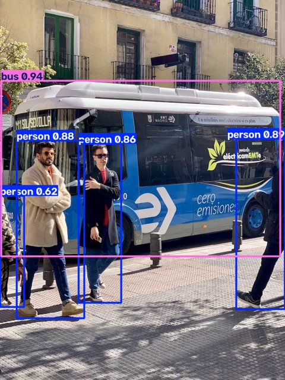

# 🔍 Object Detection Web App (YOLO11)

A web app and batch tool that detects 80 types of everyday objects — people, vehicles, animals, household items — in photos or from a webcam, using a pretrained **YOLO11** model.



## Features

- **Web demo** (Gradio): upload, paste or take a webcam photo; adjust the confidence threshold; filter to specific classes
- **Batch CLI**: process a whole folder and export a `detections.csv` report
- **Clean separation**: model logic lives in [`detector.py`](detector.py) and is reused by the UI, the CLI and the tests
- **Fast on CPU**: ~56 ms per image with `yolo11n` on a laptop CPU, no GPU required

## Run it

```bash
python -m venv .venv
.venv\Scripts\activate          # macOS/Linux: source .venv/bin/activate
pip install -r requirements.txt

python app.py                    # open http://127.0.0.1:7860
```

Batch mode:

```bash
python detect_folder.py path/to/photos --out results --conf 0.3 --classes person car
```

The model weights (`yolo11n.pt`, ~6 MB) are downloaded automatically on first run.

## Tests

```bash
python -m pytest
```

The tests check real detections on a sample image, that numpy and file inputs give the same result (catching RGB/BGR mix-ups), the class filter, and the confidence threshold.

## Design notes

- **RGB vs BGR**: Gradio and PIL use RGB, while Ultralytics/OpenCV expect BGR for numpy arrays. The detector converts on the way in and out, and a test guards against regressions.
- **Model size**: `yolo11n` (nano) was chosen for speed. Swap `DEFAULT_WEIGHTS` in `detector.py` for `yolo11s.pt` or `yolo11m.pt` to trade speed for accuracy.

## Next steps

- Fine-tune on a custom dataset (e.g. Thai license plates or product defects)
- Video file and live-stream processing with object tracking
- Export to ONNX for faster CPU inference
